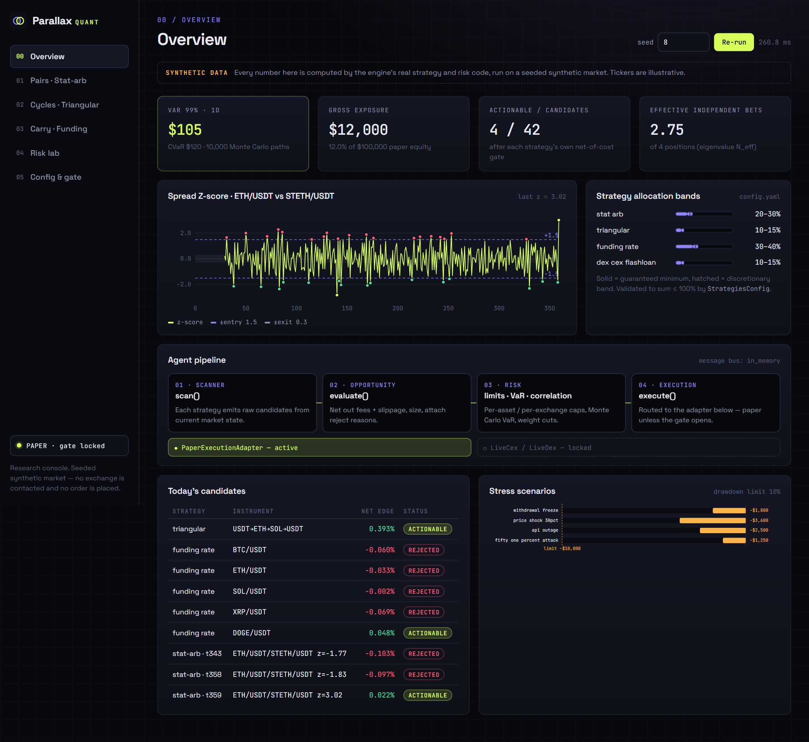
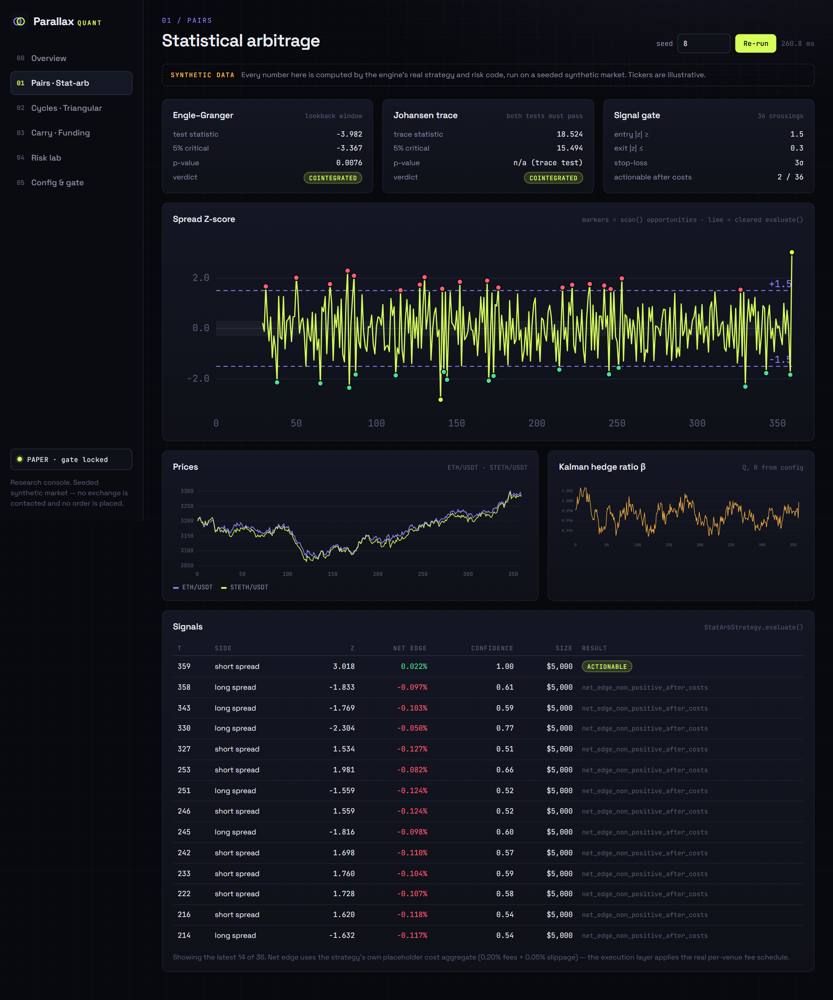
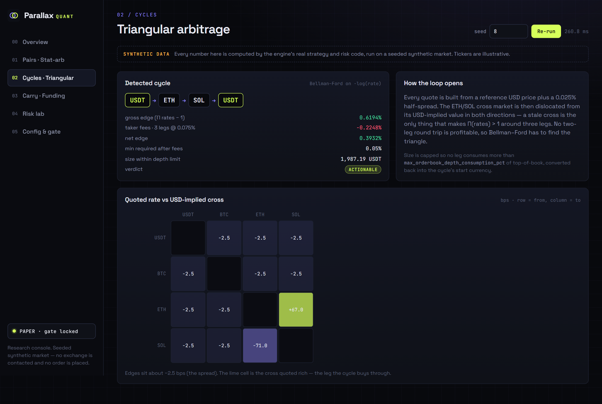
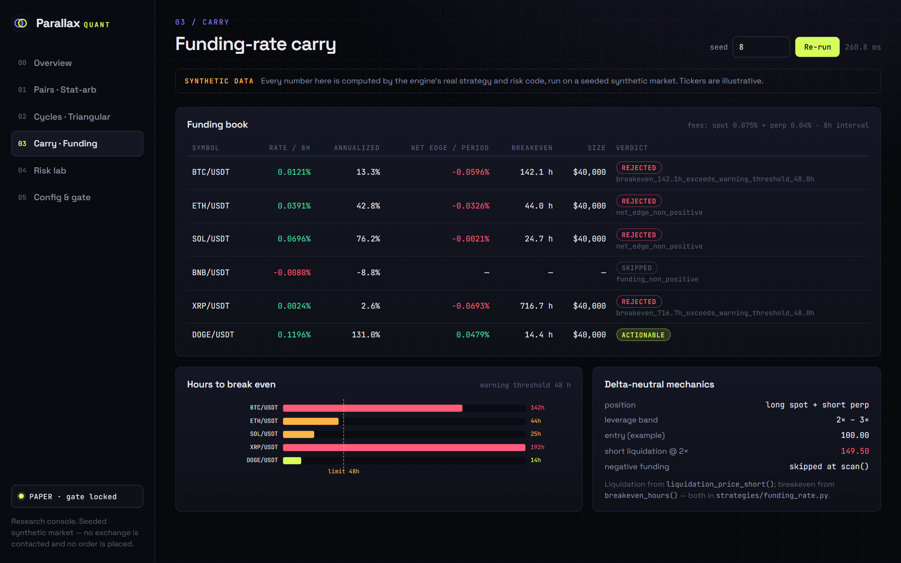
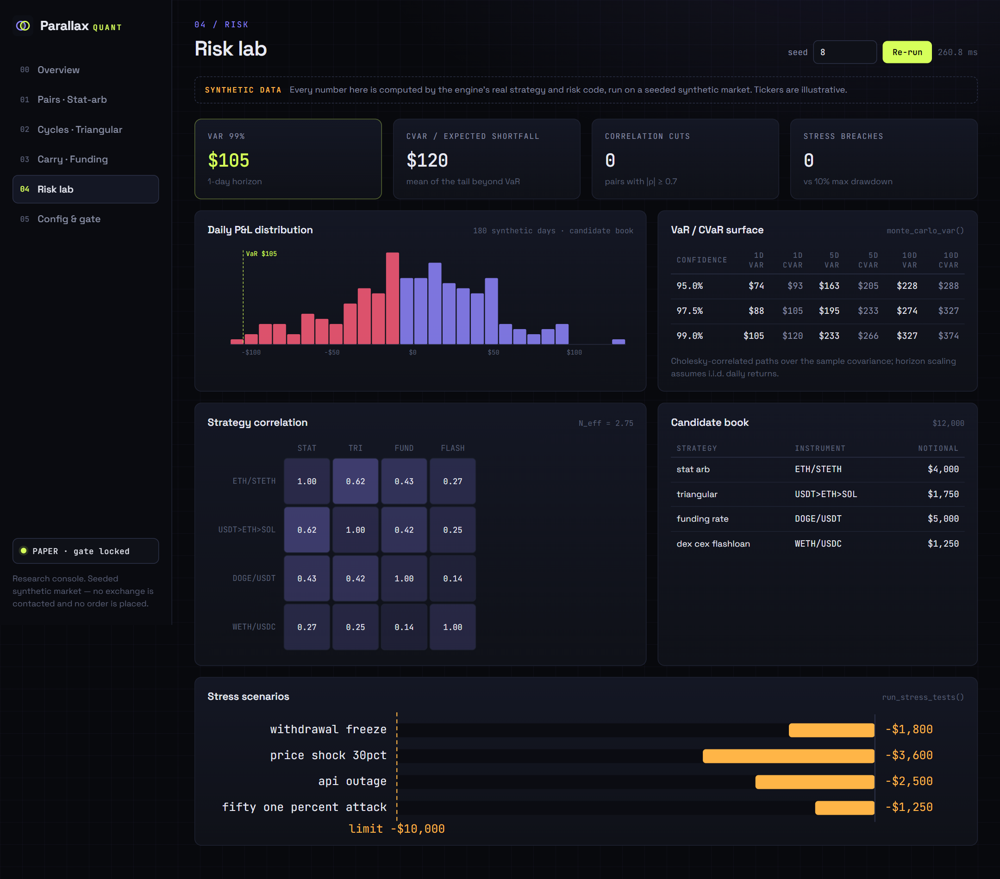
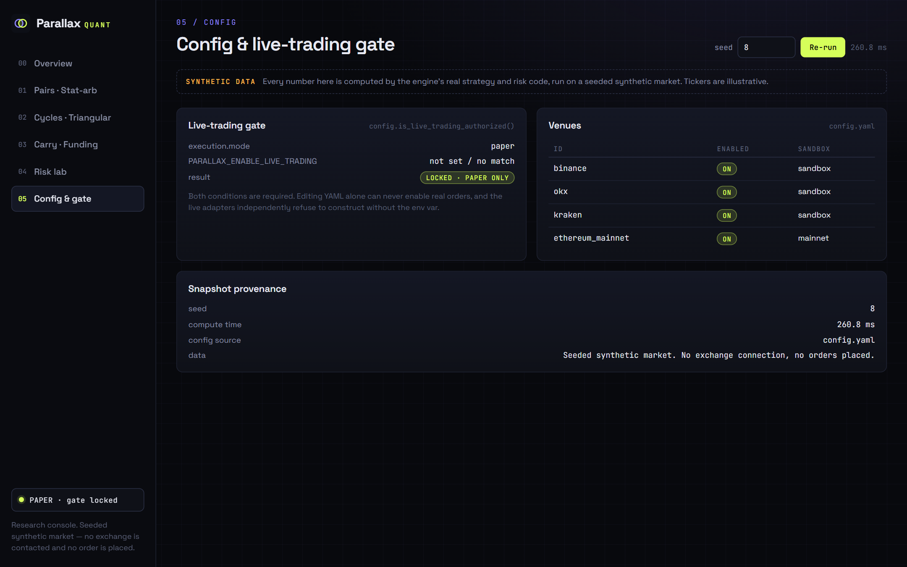
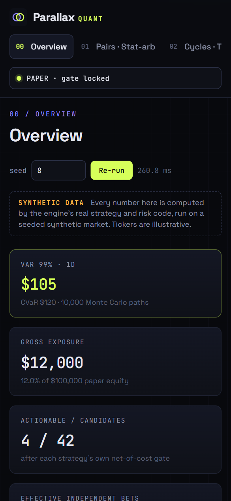

# Parallax Quant

**Status: Research / paper-trading framework.** A modular, multi-strategy
crypto arbitrage engine — real statistical, graph-theoretic, and
cost-accounting math throughout, running by default against **paper
trading only**. Live/sandbox execution code exists and is real, but is
disabled unless explicitly authorized (see [Live trading](#live-trading-explicitly-gated)
below) and has not been exercised against a funded account as part of
this build. Read [`docs/LIMITATIONS.md`](docs/LIMITATIONS.md) before
relying on anything here with real capital.




> Formerly **ArbitrageX Engine**. Renamed to Parallax Quant to keep it clearly
> distinct from the unrelated `arbitragex-pro` SaaS demo.

## What this is, precisely

Four arbitrage strategies, each implementing a common `BaseStrategy`
interface (`scan → evaluate → execute → manage_risk`), a distributed
agent pipeline (scanner → opportunity → risk → execution) communicating
over a pluggable message bus, a risk layer (VaR/CVaR via Monte Carlo,
correlation-based weight reduction, position limits, margin monitoring,
stress tests), an event-driven backtester, and full YAML-configured,
Pydantic-validated parameters for every threshold in the system.

## What this deliberately does not include

- **MEV sandwich attacks.** Extracting value from another identifiable
  trader's pending transaction is not implemented and won't be added to
  this codebase — see [`docs/LIMITATIONS.md`](docs/LIMITATIONS.md).
- **Any claim of legal/regulatory compliance.** The compliance module
  (`src/parallax_quant/compliance/`) is technical scaffolding for a
  real compliance program to plug into — it does not constitute one. See
  [`docs/COMPLIANCE.md`](docs/COMPLIANCE.md).
- **Options/volatility arbitrage, cross-chain bridge arbitrage, MEV
  liquidation bots.** Out of scope for this build; see
  [`docs/ROADMAP.md`](docs/ROADMAP.md).
- **A trained RL model.** The "learning agent" implements a real
  epsilon-greedy bandit; PPO/DQN are declared in the config schema as a
  documented future direction and raise `NotImplementedError` if selected
  — see [`docs/LIMITATIONS.md`](docs/LIMITATIONS.md).

## Strategies

| Strategy | Core math | Allocation (config default) |
|---|---|---|
| Statistical arbitrage | Engle-Granger + Johansen cointegration, Kalman-filtered hedge ratio, Z-score entry/exit, Chow-test structural-break monitoring | 20–30% |
| Triangular arbitrage | Bellman-Ford negative-cycle detection on a `-log(rate)` graph | 10–15% |
| Funding-rate arbitrage | Delta-neutral spot+perp, liquidation-price and break-even formulas | 30–40% |
| DEX-CEX flash-loan arbitrage | Aave v3 flash loan + Uniswap V2 swap via a real (unaudited) Solidity receiver contract, Flashbots-protected submission | 10–15% |

Full formulas: [`docs/STRATEGIES.md`](docs/STRATEGIES.md).

## Live trading — explicitly gated

`config/config.yaml`'s `execution.mode` defaults to `paper` and **editing
the YAML alone can never enable real trading**. Live or sandbox order
placement additionally requires the exact environment variable:

```bash
export PARALLAX_ENABLE_LIVE_TRADING=I_UNDERSTAND_THE_RISK
```

Both the mode setting and this env var are checked in
`config.is_live_trading_authorized()`, and `execution/live_cex.py` /
`execution/live_dex.py` independently refuse to construct without it.
Read [`docs/LIMITATIONS.md`](docs/LIMITATIONS.md) and
[`docs/COMPLIANCE.md`](docs/COMPLIANCE.md) first.

## Quickstart

```bash
python -m venv .venv
source .venv/bin/activate  # or .venv\Scripts\activate on Windows
pip install -e ".[dev]"

cp .env.example .env        # fill in sandbox/testnet keys if you want live data
pytest                       # run the test suite

python -m parallax_quant.main --config config/config.yaml
```

Full local + Docker Compose + Kubernetes instructions:
[`docs/DEPLOYMENT.md`](docs/DEPLOYMENT.md).

## Research console

A local, read-only web console (`src/parallax_quant/dashboard/`) that runs
the engine's **real** strategy and risk code — `StatArbStrategy.scan()/evaluate()`,
Bellman-Ford in `TriangularArbStrategy`, `FundingRateArbStrategy.evaluate()`,
`monte_carlo_var()`, `run_stress_tests()`, the live-trading gate — against a
**seeded synthetic market**, and draws the results. It contacts no exchange,
places no order, and has no write endpoints. Change the seed to re-run the
whole pipeline on a different synthetic market; some seeds deliberately fail
cointegration, and the console shows that rather than hiding it.

```bash
python -m parallax_quant.dashboard --port 8050   # or: parallax-console
# open http://127.0.0.1:8050
```

| | |
|---|---|
|  |  |
| **Pairs** — Engle-Granger + Johansen verdicts, Kalman β, Z-score with entry/exit bands, every signal and why it was rejected | **Cycles** — the Bellman-Ford loop, gross → net edge after fees, depth-capped size, rate-deviation heatmap |
|  |  |
| **Carry** — funding book, breakeven hours vs the warning threshold, liquidation price | **Risk lab** — VaR/CVaR surface, P&L distribution, strategy correlation + N_eff, stress scenarios vs drawdown limit |
|  |  |
| **Config & gate** — execution mode, env-var confirmation, venues | Responsive layout down to phone width |

All screenshots show synthetic, seeded data (seed `8`), not market data.

## Configuration

Every tunable parameter — every strategy threshold, allocation
percentage, risk limit, and execution setting — lives in
[`config/config.yaml`](config/config.yaml), validated against
[`src/parallax_quant/config.py`](src/parallax_quant/config.py)'s
Pydantic models. An invalid value fails fast at startup with the exact
field path; nothing is silently clamped.

## Architecture

```
Scanner Agent → Opportunity Agent → Risk Agent → Execution Agent
     (message bus: in-memory / RabbitMQ / Kafka)
                        │
              BaseStrategy.scan/evaluate/execute/manage_risk
                        │
         PaperExecutionAdapter (default) | LiveCex/LiveDex (gated)
```

Full diagram and module-by-module breakdown:
[`docs/ARCHITECTURE.md`](docs/ARCHITECTURE.md).

## Project structure

```
src/parallax_quant/
  config.py          Pydantic schema + YAML loader + live-trading gate
  data/               feeds (CEX websocket via ccxt, DEX via web3), rate limiting, NTP sync, TimescaleDB storage
  strategies/         BaseStrategy + 4 strategies + Kalman filter, cointegration, rate graph
  risk/               VaR/CVaR, correlation, position limits, stress tests, margin monitor
  execution/          paper (default) / live CEX / live DEX flash-loan adapters
  agents/             message bus, scanner/opportunity/risk/execution agents, orchestrator, learning agent
  backtest/           event-driven engine, slippage/fee models, performance metrics
  compliance/         AML/KYC provider interface (scaffolding), audit log
  monitoring/         Prometheus metrics
  dashboard/          local research console (stdlib HTTP server + static UI)
contracts/            FlashArbReceiver.sol (Aave v3 flash-loan receiver, NOT audited)
tests/                pytest suite — see docs/TESTING.md for what's covered
docker/               Dockerfile, docker-compose.yml (Timescale/Redis/RabbitMQ/Prometheus/Grafana)
k8s/                  Deployment, Service, ConfigMap, Secret example
monitoring/           Prometheus config, Grafana dashboard JSON
docs/                 full documentation suite (below)
```

## Documentation index

| Doc | Covers |
|---|---|
| [ARCHITECTURE.md](docs/ARCHITECTURE.md) | Module-by-module design, message flow |
| [STRATEGIES.md](docs/STRATEGIES.md) | Every formula, with the exact config parameter that drives it |
| [RISK.md](docs/RISK.md) | VaR methodology, stress scenarios, limits |
| [COMPLIANCE.md](docs/COMPLIANCE.md) | What the compliance scaffolding is and is **not** |
| [SECURITY.md](docs/SECURITY.md) | Security review of this codebase |
| [DEPLOYMENT.md](docs/DEPLOYMENT.md) | Local, Docker Compose, Kubernetes |
| [TESTING.md](docs/TESTING.md) | What's tested, real coverage numbers, what isn't |
| [LIMITATIONS.md](docs/LIMITATIONS.md) | Honest REAL/IMPLEMENTED/SCAFFOLDING/NOT IMPLEMENTED breakdown |
| [ROADMAP.md](docs/ROADMAP.md) | What's deliberately deferred and why |
| [DECISIONS.md](docs/DECISIONS.md) | Engineering decision log |

## License

MIT — see [`LICENSE`](LICENSE). This is research/engineering infrastructure,
not investment advice, and carries no warranty of fitness for live
trading — see [`LICENSE`](LICENSE) and [`docs/LIMITATIONS.md`](docs/LIMITATIONS.md).
